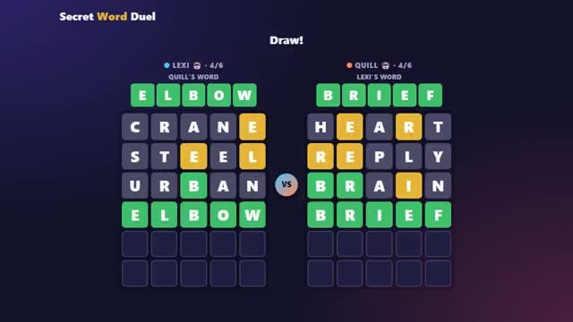

# Secret Word Duel

Pick a secret word. Crack theirs first. A multiplayer starter game from [Multiplayer Agent](https://multiplayeragent.com): 2D, versus, 2 players, with a bot that takes an empty seat.

## How it plays

Each player picks a secret 5-letter word, then you take turns guessing the other's. Green is the right letter in the right spot, yellow is in the word somewhere, grey is not in it; fewest guesses wins.

**Controls:** Type or tap the on-screen keyboard, Enter to guess.

## Make it yours in the Game Builder

Open the [Game Builder](https://multiplayeragent.com), choose **Start from a starter game** and pick Secret Word Duel. It opens as version 1 in your studio, ready to play and publish. Then ask for changes, for example:

- Make the words 6 letters long
- Add a hint button that costs one guess
- Use only animal names as secret words

## Run it yourself

1. Get a free publishable key (`pk_…`) at [multiplayeragent.com](https://multiplayeragent.com).
2. In `index.html`, put it in place of `pk_REPLACE_ME` in the `MP_CONNECT` block.
3. Open `index.html` in a browser. No build step and no server needed.

Without a key it still runs, offline against a bot.

## How it is built

- One `index.html`. The comment at the top of the script maps the code and explains the multiplayer.
- **Hidden info:** Your word is sealed so only you can read it (the host checks the clues, so it can too).
- **Host-run rules:** The host's browser checks every guess and works out the clues; if it leaves, the next player takes over.
- **Bots:** A bot rival takes the empty seat, and a friend who joins takes it at the next pick.
- **Leaderboard:** Duels won, shown after every duel.
- The word list is in the `WORDS` section: add or remove words there.
- `?attract` runs it offline with two bots. The preview video is recorded from it.

## License

MIT.
